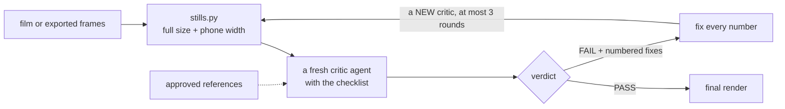
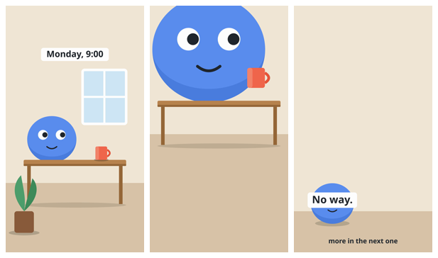

<div align="center">

# art-director-round

**A Claude skill: before a final render, a separate critic looks at stills of every shot and says PASS or FAIL.**

Measurements cannot see design. A film can hit every number and still have a head cut by the frame,
a mug that floats and a caption over a face. Those are found by looking, and not by the one who made it.


</div>

---

## What it does



| Part | What it is |
|---|---|
| [`SKILL.md`](SKILL.md) | The method and the checklist: composition, dead space, the set, props, acting, finish |
| [`critic-brief.md`](critic-brief.md) | The whole task for the critic, to fill in and hand over |
| [`scripts/stills.py`](scripts/stills.py) | Pulls stills from a video at full size and at phone width, and builds two contact sheets |
| [`examples/`](examples/) | A real round on a film with five planted faults |

## A real round

A six-second test film was drawn with five faults put in on purpose. A fresh critic got the brief, the checklist
and the stills. It was not told about the faults.

<table>
<tr>
<td width="46%"></td>
<td>

| Planted | Found |
|---|---|
| Head cut by the frame | fix 8 |
| Mug floats, no contact shadow | fix 5 |
| Caption over the eyes | fix 1 |
| Text in the bottom 20 % | fix 2 |
| Empty wall, over a quarter of the frame | fix 3 |

**Five of five**, each with its time and checklist section.

</td>
</tr>
</table>

It also returned ten fixes that were not planted. Four of them were in the shot its author had written down as
"meant to be clean":

> 9. 1.0 s and 3.0 s — the character's underside is cut flat by the tabletop and has no contact shadow on it, so
> it reads as sunk into or standing behind the table, not sitting on it

The maker knew what the shot was meant to be and did not see it. That is what the round is for.
[The whole verdict, unedited, and what this one run does not show](examples/critic-round-1.md).

## Install

```bash
git clone https://github.com/DevCrazyCube/claude-skill-art-director-round ~/.claude/skills/art-director-round
```

`stills.py` needs `ffmpeg` and `ffprobe` on the PATH and Python 3.9 or newer. Nothing to `pip install`.

## Use

Ask for it in words:

```text
Run an art-director round on out/film.mp4 before the final render.
```

Or run the parts yourself:

```bash
# 1. stills: one a second, or at the shots' own times
python3 scripts/stills.py film.mp4 --out review/
python3 scripts/stills.py film.mp4 --out review/ --at 0.4,2.0,3.5,5.5
```

On the six-second test film of the example round, the second line printed:

```text
4 stills from flawed.mp4 (6.0 s, 1080x1920) in review/: full/, phone/ (390 px), two sheets
```

```
review/
  full/t000.40.png  t002.00.png  …     the film's own size
  phone/t000.40.png t002.00.png  …     390 px wide: what a phone shows
  sheet-full.png  sheet-phone.png      contact sheets, in time order
  index.json                           times, file names, film size
```

Then give a **fresh** agent [`critic-brief.md`](critic-brief.md) with the folder filled in. It returns:

```text
VERDICT: FAIL (round 1 of 3)

1. Shot or time — what is wrong, in one sentence. Checklist section.
…
Passed: the sections with nothing to fix.
Judged against: which references it used.
```

Fix every number, pull new stills, start a **new** critic. At most three rounds; if the third fails, the list goes
to the owner and nothing is rendered.

<details>
<summary><b>stills.py options</b></summary>

| Option | Default | |
|---|---|---|
| `--out DIR` | required | where the stills go |
| `--every S` | `1` | one still every S seconds, starting half a step in |
| `--at t1,t2,…` | | stills at these times instead; a time outside the film is refused |
| `--phone PX` | `390` | the phone width |
| `--columns N` | all in a row, up to 6 (4 for landscape) | stills per row on the sheets |

Exit code 0 on success, 2 on a missing film, a missing ffmpeg or a bad time. A file's name is its time in the
film (`t003.10.png` is 3.1 s), so a critic can name a fix by its time.

</details>

<details>
<summary><b>The checklist, in short</b></summary>

| Section | It asks |
|---|---|
| **Composition** | On a third or centred? Headroom consistent? Nothing cut by the frame? Shot sizes distinct? Eyelines match? |
| **Dead space** | Is any quarter of the frame empty without a purpose? |
| **The set** | Does the place read in half a second? Depth? One light, one side? Subject separates in value? |
| **Props** | Held believably? Contact shadows? Text on a prop readable at phone width? |
| **Acting** | Poses read as silhouettes? Expressions readable on a phone? First frame an unmistakable pose? |
| **Finish** | Nothing floats or clips? Captions clear of faces? Words out of the top 12 % and bottom 20 %? |

One fail on any line is a FAIL for the piece. The full lines are in [`SKILL.md`](SKILL.md).

</details>

<details>
<summary><b>The rules that make it a round</b></summary>

- The critic is never the maker, and never an agent that saw an earlier round.
- Both sizes, always. Most fails only show at 390 px.
- The critic judges; it does not fix. The one who fixes does not judge the fix.
- Do not argue with a fix in the next brief. If you think a fix is wrong, the owner decides.
- A PASS is not praise. It means nothing on the list failed.

</details>

## Tests

```bash
python3 -m unittest discover -s tests
```

Eleven tests. Six check the times (`--every`, `--at`, a film shorter than one step, names that sort in time
order). Five run on a film the test generates with ffmpeg, one flat colour a second, so a still's colour says
which second it came from: stills land in the right second, full and phone sizes are right, the sheets hold every
still in order, and the command line refuses a missing film and a time outside it. Those five are skipped when
ffmpeg is not installed.

To redo the example round, draw the film (this one also needs `rsvg-convert`, from librsvg):

```bash
python3 examples/make_flawed_film.py flawed.mp4
python3 scripts/stills.py flawed.mp4 --out review/ --every 2
```

## Repo layout

```
SKILL.md                          what Claude reads: how to run the round, the checklist, the rules
critic-brief.md                   the critic's whole task
scripts/stills.py                 stills at two sizes + contact sheets (standard library + ffmpeg)
tests/test_stills.py              11 tests
examples/make_flawed_film.py      draws the test film with five planted faults
examples/sheet-phone.png          its stills at phone width
examples/critic-round-1.md        the critic's verdict on it, unedited
```

## Related

- [`claude-skill-film-ear-eye`](https://github.com/DevCrazyCube/claude-skill-film-ear-eye) measures what this round cannot: loudness, sound events, camera speed and easing.
- [`claude-skill-cold-read`](https://github.com/DevCrazyCube/claude-skill-cold-read) is the same idea for words: a reader that has seen nothing.

## License

MIT
