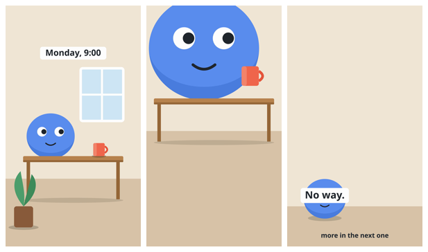

# A real round: five planted faults, one fresh critic

The film: six seconds, three shots, drawn by [`make_flawed_film.py`](make_flawed_film.py) with five faults put in
on purpose. The critic was a fresh agent. It got the brief from [`critic-brief.md`](../critic-brief.md), the
checklist, and the folder of stills. It was not told the film was a test, that faults were planted, or how many.
No references were given.



Stills made with:

```bash
python3 examples/make_flawed_film.py flawed.mp4
python3 scripts/stills.py flawed.mp4 --out review/ --every 2
```

## What was planted

| # | Shot | Fault | Checklist section |
|---|---|---|---|
| 1 | 2 (3.0 s) | The head is cut by the top of the frame | Composition |
| 2 | 2 (3.0 s) | The mug floats above the desk, no contact shadow | Props |
| 3 | 3 (5.0 s) | The caption covers the character's eyes | Finish |
| 4 | 3 (5.0 s) | A line of text sits in the bottom 20 % | Finish |
| 5 | 3 (5.0 s) | More than a quarter of the frame is empty wall | Dead space |

## The critic's answer, unedited

```text
VERDICT: FAIL (round 1 of 3)

1. 5.0 s — the "No way." caption sits across the character's eyes, so the face is hidden and only a 27 px mouth is left at phone width. Finish (captions never cover a face) and Acting (expression readable at phone width).
2. 5.0 s — "more in the next one" sits at about 95 % of the frame height, and the character (72–88 %) and the "No way." caption (76–82 %) are also in or on the edge of the bottom 20 %, where the app's interface covers them. Finish (safe zones).
3. 5.0 s — the top ~70 % of the frame is bare wall with no caption in it and nothing moving into it, and the character is jammed into the bottom-left corner. Dead space, Composition.
4. 3.0 s — the bottom ~43 % of the frame (everything below the table's shadow) is empty floor. Dead space.
5. 3.0 s — the mug hangs in the air about 100 px above the tabletop, overlapping the character's right edge, with no hand on it and no shadow (it had a contact shadow on the table at 1.0 s). Props (held, contact shadow) and Finish (nothing floats).
6. 3.0 s — the mug's coral and the character's blue are almost the same value (both around 137–139 luminance), so where the mug overlaps the body it separates in colour only. The set (separates in value).
7. 3.0 s — the character is 2.3x larger than at 1.0 s while the table is only 1.2x wider and its legs are the same length, and the mug is 1.5x; this reads as the character inflating, not a closer camera. Props (believable scale).
8. 3.0 s — the top of the head is cut by the frame and the eyes sit at 9–18 % of the frame height, inside the top 12 % interface zone; the body is centred at 43 % of the width, neither on the third nor on the centre. Composition (no head cut, on a third or centred) and Finish (safe zones).
9. 1.0 s and 3.0 s — the character's underside is cut flat by the tabletop and has no contact shadow on it, so it reads as sunk into or standing behind the table, not sitting on it (the mug at 1.0 s and the character at 5.0 s do have shadows). Props (contact shadow) and Finish (clips through).
10. 1.0 s → 3.0 s → 5.0 s — the set does not hold: the window and the plant are gone at 3.0 s although that framing should still show them, the table, mug, window and plant are all gone at 5.0 s, and the floor line jumps from 72 % to 52 % to 83 % of the frame height. At 5.0 s the place is a blank wall and floor that does not read as the same room. The set (where we are reads, depth).
11. 3.0 s and 5.0 s — nothing in front of the subject and nothing behind it but flat wall; only 1.0 s has foreground (plant), midground (table) and background (window). The set (depth).
12. 1.0 s — the light does not agree: the window is on the right, the mug's highlight is on its left edge, and the character is shaded only along the bottom as if lit from straight above; at 3.0 s and 5.0 s there is no directional cue at all. The set (one key light, one side, same in every shot).
13. 1.0 s / 3.0 s / 5.0 s — headroom is roughly 45 % of the frame above the head at 1.0 s, negative (head cropped) at 3.0 s, and 72 % at 5.0 s. Composition (headroom consistent).
14. 1.0 s — the first frame is a round body sitting still with a neutral smile; it is not doing anything, and the mug it presumably cares about is untouched 150 px away. Acting (first frame is an unmistakable pose).
15. 1.0 s, 3.0 s, 5.0 s — the silhouette is the same plain ellipse and the face is the same small smile with pupils to the right in all three shots; no pose or expression change reads anywhere. Acting (pose reads as a silhouette, expression big enough).

Passed: shot sizes (wide, close, very wide are clearly distinct); eyelines at 1.0 s and 3.0 s (pupils toward the mug, matching across the cut); text on props (none); the "Monday, 9:00" caption (clear of the top 12 %, covers nothing, readable at phone width); contact shadows under the mug, the table and the plant pot at 1.0 s and under the character at 5.0 s.

Judged against: no references were given; judged against the checklist alone. All six stills were opened at both sizes (full and phone), plus both contact sheets.
```

## Planted against found

| Planted | Found as | |
|---|---|---|
| 1. Head cut by the frame | fix 8 | found |
| 2. Floating mug, no shadow | fix 5 | found |
| 3. Caption over the eyes | fix 1 | found |
| 4. Text in the bottom 20 % | fix 2 | found |
| 5. Empty wall | fix 3 | found |

Five of five. Each was named with its time and its checklist section.

## The ten that were not planted

The critic returned fifteen fixes, not five. The other ten (4, 6, 7 and 9 to 15) are faults of the test drawing
that its author did not see: shot 1 was written as "meant to be clean", and the critic found four things wrong
with it (9, 12, 14, 15). Looking at the still again, each one is there:

- the character has no contact with the desk it sits behind (9);
- the mug's highlight and the window disagree about where the light is (12);
- the character is the same ellipse with the same face in all three shots (14, 15).

That is the point of the round. The maker knew what shot 1 was meant to be and read it as clean.

## What this run does not show

- **One critic, one film, one run.** Five of five here is not a detection rate.
- **No false-positive check.** Nobody independent judged whether all ten extra fixes are right. Fix 7 (scale) and
  fix 10 (the set changes between shots) describe choices that a real film might make on purpose; here they are
  accidents of a crude test drawing.
- **A crude drawing is an easy target.** A nearly finished film has smaller faults. Whether the critic finds a
  6 px float as reliably as a 100 px one was not tested.
- **No references were given**, so this run says nothing about how the critic uses them.
